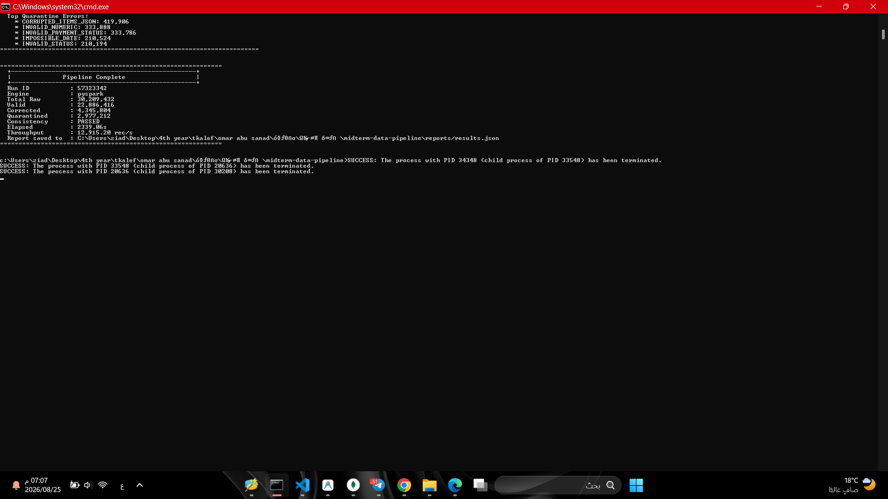
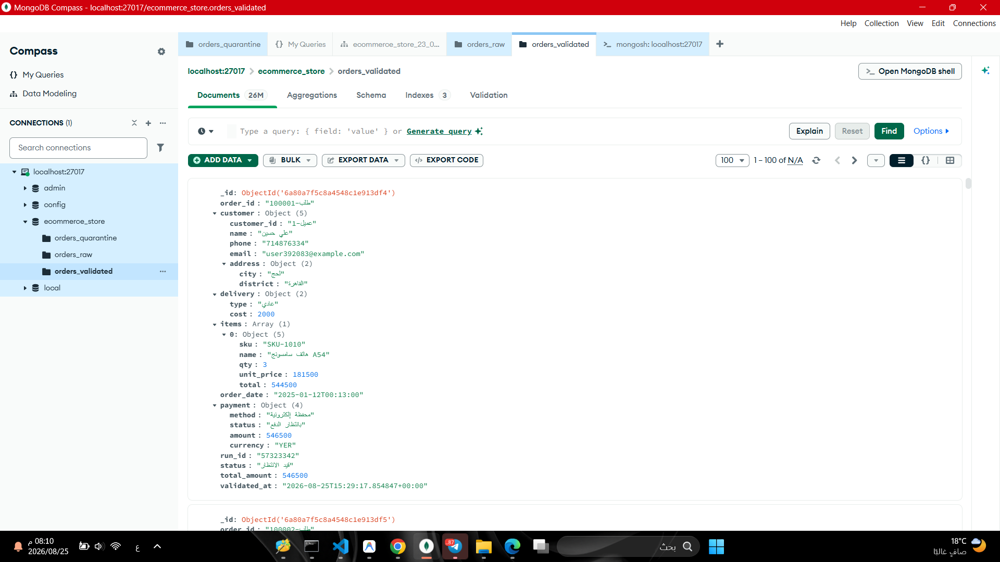
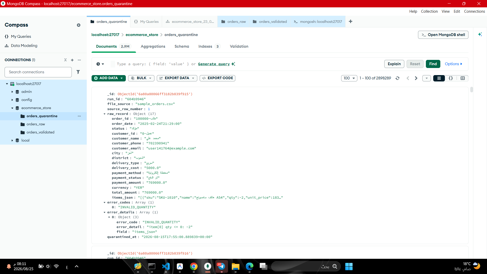

# مشروع خط البيانات الهجين (Hybrid ELT Data Pipeline)
### معالجة وتدقيق بيانات طلبات التجارة الإلكترونية الضخمة (E-Commerce Big Data)

---

> **المقرر:** البيانات الضخمة (العملي) — Big Data (Practical)  
> **الجامعة:** جامعة الرازي — Al-Razi University  
> **إشراف:** م. عمر أبو سند (Eng. Omar Abu Sanad)  
> **إعداد الطالب:** طارق (Tariq)  

---

## 📑 الفهرس | Table of Contents
- [المرحلة الثانية: الإضافات النهائية (Phase 2 - 7 Marks)](#-المرحلة-الثانية-الإضافات-النهائية--phase-2)
  - [واجهة API الموحدة للتشغيل والاختبار (FastAPI)](#1-واجهة-api-الموحدة-للتشغيل-والاختبار-fastapi)
  - [الاستعلامات والفهارس وExplain](#2-الاستعلامات-والفهارس-وخطة-التنفيذ-explain)
  - [تقارير التجميع التحليلية (Aggregations)](#3-تقارير-التجميع-التحليلية-aggregations)
  - [العروض المادية والتحديث التزايدي (Materialized Views)](#4-العروض-المادية-والتحديث-التزايدي-materialized-views)
  - [المهام المجدولة (Scheduled Jobs)](#5-المهام-المجدولة-scheduled-jobs)
- [نبذة عن المشروع النصفي | Midterm Overview](#-نبذة-عن-المشروع--overview)
- [الميزات الرئيسية | Key Features](#-الميزات-الرئيسية--key-features)
- [المتطلبات الأساسية | Prerequisites](#-المتطلبات-الأساسية--prerequisites)
- [خطوات التثبيت والإعداد | Installation & Setup](#-خطوات-التثبيت-والإعداد--installation--setup)
- [دليل التشغيل السريع | Quick Start Guide](#-دليل-التشغيل-السريع--quick-start-guide)
- [هيكل المشروع | Project Structure](#-هيكل-المشروع--project-structure)
- [مجموعات قاعدة البيانات | MongoDB Collections](#-مجموعات-قاعدة-البيانات--mongodb-collections)
- [تشغيل الاختبارات الآلية | Running Tests](#-تشغيل-الاختبارات-الآلية--running-tests)


---

---

# 🚀 المرحلة الثانية: الإضافات النهائية (Big Data - Phase 2)
> **ملاحظة أكاديمية:** المشروع النصفي مستقل ومحتفظ بدرجته (18 درجة)، وهذا القسم يوثق الإضافات الجديدة الخاصة بالمشروع النهائي (7 درجات).

---

### 🌟 ملخص مكونات المرحلة الثانية:
1. **واجهة API موحدة (FastAPI):** بوابة تشغيل قياسية لجميع وظائف المشروع مع وثائق Swagger تفاعلية على `/docs`.
2. **الاستعلامات والفهارس وExplain:** 5 استعلامات عملية + 5 فهارس متقدمة (تتضمن فهارس مركبة Compound ومصفوفية Multikey) + مقارنة وتحليل أداء خطة التنفيذ `explain("executionStats")` قبل وبعد الفهرسة وتوثيق الانخفاض الهائل في عدد المستندات المفحوصة (توفير يصل إلى **99.94% - 100%**).
3. **تقارير التجميع (Aggregations):** 5 تقارير تحليلية شاملة للبيانات تغطي المبيعات بالمدن، أفضل المنتجات، كبار العملاء، الاتجاهات الزمنية، وتوزيع الحالات.
4. **العروض المادية الذكية (Materialized Views):** جدولان ماديان (`daily_sales_summary`, `top_products_summary`) مدعومان بآلية **تحديث تزايدي ذكي (Incremental Refresh)** تستفيد من علامات التدفق (Watermark) لتحديث التواريخ أو الأصناف المتأثرة فقط دون إعادة حساب السجلات القديمة.
5. **المهام المجدولة (Scheduled Jobs):** مهمتان مجدولتان تعملان دورياً وفق جدول زمني مع إمكانية التشغيل اليدوي الفوري وتوثيق تفاصيل التنفيذ في MongoDB.

---

## 1. واجهة API الموحدة للتشغيل والاختبار (FastAPI)

تم توفير خادم ويب مبني بواسطة **FastAPI** لتمكين لجان التحكيم وأنظمة التقييم الآلية من تشغيل واختبار جميع الوظائف دون الحاجة لكتابة أوامر يدوية أو تخمين أي خطوات.

### تشغيل خادم الـ API:
```bash
# الطريقة المباشرة عبر الملف الدفعي:
run_api.bat

# أو عبر سطر الأوامر:
python -m uvicorn src.api:app --host 0.0.0.0 --port 8000 --reload
```
- **رابط صفحة Swagger التفاعلية:** [http://localhost:8000/docs](http://localhost:8000/docs)
- **رابط فحص صحة النظام:** [http://localhost:8000/health](http://localhost:8000/health)

### جدول المسارات الإلزامية المنفذة في الـ API:

| المسار (Endpoint) | الطريقة (Method) | الوصف والغرض |
| :--- | :---: | :--- |
| `/health` | `GET` | فحص اتصال MongoDB وتعداد السجلات في كافة المجموعات والعروض المادية |
| `/ingest` | `POST` | تشغيل خط إدخال ومعالجة البيانات النصفي (يدعم تمرير مسار ملف CSV مخصص) |
| `/indexes` | `POST` | إنشاء كافة الفهارس المحسنة وقياس زمن الإنشاء |
| `/queries` | `GET` | سرد الاستعلامات الخمسة المتاحة مع وصفها ومعاملاتها الافتراضية |
| `/queries/{name}` | `GET` | تنفيذ استعلام محدد بالاسم مع إمكانية تمرير معاملات وتفعيل `explain=true` |
| `/aggregations` | `GET` | سرد تقارير التجميع الخمسة المتاحة |
| `/aggregations/{name}` | `GET` | تنفيذ تقرير تجميع محدد واسترجاع البيانات التحليلية بصيغة JSON |
| `/refresh-mv` | `POST` | تحديث العروض المادية تزايدياً (`incremental`) أو كلياً (`full`) |
| `/jobs` | `GET` | عرض قائمة بالمهام المجدولة وسجلات التنفيذ السابقة |
| `/jobs/{name}/run` | `POST` | تشغيل فوري يدوي لمهمة محددة واختبارها |
| `/explain-benchmarks` | `GET` | تشغيل وتوليد تقرير المقارنة قبل وبعد الفهارس وتحديث ملفات النتائج |

---

## 2. الاستعلامات والفهارس وخطة التنفيذ (Explain)

### الاستعلامات العملية الخمسة:
1. `orders_by_status_and_date`: استعلام الطلبات حسب الحالة ونطاق التاريخ مرتبة تنازلياً. (يخدمه: `idx_status_order_date`).
2. `customer_order_history`: استعلام سجل ومشتريات العميل برقم الهاتف. (يخدمه: `idx_customer_phone`).
3. `high_value_orders_by_city`: استعلام الطلبات عالية القيمة في مدينة معينة لاستهداف العملاء المميزين. (يخدمه: `idx_city_total_amount`).
4. `product_item_search`: استعلام البحث داخل مصفوفة عناصر الطلب عن رمز منتج معين `items.sku`. (يخدمه: `idx_items_sku`).
5. `pending_cash_deliveries`: استعلام الطلبات قيد الشحن/المؤكدة بنظام الدفع عند الاستلام لمتابعة التحصيل. (يخدمه: `idx_payment_method_status`).

### الفهارس المنشأة في MongoDB:
1. **فهرس مركب (Compound Index):** `[("status", 1), ("order_date", -1)]`
2. **فهرس فردي (Single Index):** `[("customer.phone", 1)]`
3. **فهرس مركب (Compound Index):** `[("customer.address.city", 1), ("total_amount", -1)]`
4. **فهرس متعدد المفاتيح (Multikey Index):** `[("items.sku", 1)]`
5. **فهرس مركب (Compound Index):** `[("payment.method", 1), ("payment.status", 1)]`

### نتائج مقارنة Explain ExecutionStats (قبل وبعد الفهارس):
تم تنفيذ مقارنة عملية دقيقة لـ 3 استعلامات على قاعدة البيانات المحتوية على **87,312** سجل سليم:

| الاستعلام | نوع الفهرس المستخدم | المرحلة قبل | المرحلة بعد | المستندات المفحوصة (قبل) | المستندات المفحوصة (بعد) | نسبة التوفير |
| :--- | :--- | :---: | :---: | :---: | :---: | :---: |
| **الطلبات حسب الحالة والتاريخ** | `idx_status_order_date` (Compound) | `SORT` (Collscan) | `LIMIT` (Index Scan) | 87,312 | 50 | **99.94%** |
| **سجل العميل برقم الهاتف** | `idx_customer_phone` (Single) | `SORT` (Collscan) | `SORT` (Index Scan) | 87,312 | 1 | **100.0%** |
| **الطلبات عالية القيمة بالمدينة** | `idx_city_total_amount` (Compound) | `SORT` (Collscan) | `LIMIT` (Index Scan) | 87,312 | 50 | **99.94%** |

> **التعليل الفني:**
> - **فهرس الحالة والتاريخ:** يعتمد مبدأ `Equality -> Sort -> Range` (ESR)، ما يقضي تماماً على مرحلة الفرز في الذاكرة ومسح المجموعة الشامل.
> - **فهرس رقم الهاتف:** ينقل البحث من تعقيد خطي $O(N)$ يفحص كل سجلات المتجر إلى قفزة شجرة ثنائية $O(\log N)$ تصل للعميل فوراً.
> - **فهرس المدينة والمبلغ:** يجمع حقل التصفية مع حقل الترتيب في شجرة الفهرس ذاتها، مما يمكن المحرك من قراءة أعلى الطلبات دون فحص باقي المدينة.

---

## 3. تقارير التجميع التحليلية (Aggregations)

تم تنفيذ 5 تقارير تجميع تحليلية متقدمة عبر Aggregation Pipelines تعيد نتائج واقعية ومفيدة لصناع القرار:

1. **`sales_by_city` (المبيعات حسب المدينة):** تجميع حسب المدينة لحساب إجمالي المبيعات، عدد الطلبات، متوسط قيمة السلة، ونسبة الطلبات المسلمة.
2. **`top_products` (أفضل المنتجات مبيعاً):** استخدام مرحلة `$unwind: "$items"` لتفكيك السلع المضمنة، وتجميع المبيعات حسب الصنف لإيجاد أكثر المنتجات جلباً للإيرادات والكميات المباعة.
3. **`top_customers` (كبار العملاء VIP):** تجميع سجلات العملاء لحساب إجمالي الإنفاق، وتكرار الشراء، وتاريخ آخر عملية طلب.
4. **`sales_by_period` (المبيعات حسب الفترة):** استخراج الشهر أو اليوم من حقل التاريخ (`$substrCP`) وتحليل نمو المبيعات عبر الزمن.
5. **`order_status_distribution` (توزيع الطلبات حسب الحالة):** تحليل توزيع الحالات التشغيلية (مسلم، ملغي، مرتجع، قيد الشحن) مع حساب متوسط تكلفة الشحن وقيمة المبيعات لكل حالة.

---

## 4. العروض المادية والتحديث التزايدي (Materialized Views)

تم إنشاء جدولين ماديين (Materialized Views) في MongoDB:
1. **`daily_sales_summary`:** ملخص يومي تراكمي يتضمن إجمالي المبيعات، عدد الطلبات، عدد المسلّم، وعدد الملغي.
2. **`top_products_summary`:** ملخص أداء المنتجات يتضمن رمز الصنف، اسم المنتج، إجمالي الكمية المباعة، والإيرادات.

### آلية التحديث التزايدي الذكية (Incremental Refresh via Watermark):
- يتم تتبع علامة التدفق الزمنية (`last_watermark`) في مجموعة بيانات التعريف `materialized_view_metadata`.
- عند طلب التحديث بالوضع التزايدي (`mode="incremental"`):
  1. يقوم النظام بفحص السجلات الجديدة التي أضيفت بعد آخر علامة تدفق (`validated_at > watermark`).
  2. في حال عدم وجود سجلات جديدة، يعود النظام فوراً في أجزاء من الثانية (`UP_TO_DATE`) دون هدر موارد الخادم.
  3. في حال وجود بيانات جديدة، يتم استخراج التواريخ أو الأصناف المتأثرة فقط وحساب التجميع لها ودمجها عبر مرحلة `$merge` بخاصية `whenMatched: "replace"` دون إعادة بناء المجموعة بأكملها!

---

## 5. المهام المجدولة (Scheduled Jobs)

تم بناء نظام إدارة وجدولة مهام تلقائي يعمل في خيط خلفي (Background Daemon Thread):

### المهام المنفذة:
1. **`refresh_materialized_views`:** تعمل دورياً كل 5 دقائق لتشغيل التحديث التزايدي للعروض المادية وحفظ أحدث مؤشرات المبيعات.
2. **`generate_periodic_kpi_report`:** تعمل دورياً كل 10 دقائق لتوليد لقطة إحصائية شاملة وحفظها في مجموعة `periodic_reports`.

### إمكانيات الاختبار والتوثيق:
- **التشغيل اليدوي الفوري:** يمكن تشغيل أي مهمة يدوياً في أي لحظة عبر الـ API:
  `POST /jobs/{name}/run`
- **سجل التنفيذ (Execution Logging):** تسجل كل عملية تنفيذ في مجموعة `job_execution_logs` في MongoDB موثقة:
  `job_id`, `job_name`, `trigger_type`, `start_time`, `end_time`, `duration_seconds`, `status` (`SUCCESS` / `FAILED`), `result`.

---

## 📖 نبذة عن المشروع النصفي | Midterm Overview

**مشروع خط البيانات الهجين (Hybrid ELT Data Pipeline)** هو نظام متكامل مصمم لمعالجة وتدقيق وتحميل بيانات طلبات التجارة الإلكترونية اليمنية غير المنتظمة وذات الجودة المتفاوتة (Messy & Mixed-Quality Data). 

يتبنى المشروع نمط **ELT (Extract - Load - Transform)** الحديث؛ حيث يتم استخراج وحفظ البيانات الأولية كما هي بدون أي تعديل في مستودع البيانات الخام، ثم تطبيق محرك تدقيق وتنظيف فائق الذكاء يطبق 10 قواعد تنظيف متخصصة لدعم البيانات العربية، وتصنيف السجلات إلى ثلاث فئات: **سليمة (Valid)**، **مصححة مع سجل تدقيق (Corrected with Audit Trail)**، أو **معزولة (Quarantined)** مع توثيق أسباب العزل بدقة.

### المحرك الهجين الذكي (Hybrid Engine):
- 🔹 **Python Batch Streaming Loader:** مخصص للملفات الصغيرة والمتوسطة ($\le 200\text{ MB}$)، يعتمد على القراءة التدفقية السطرية لتوفير استهلاك الذاكرة العشوائية (RAM).
- 🔹 **PySpark Parallel Loader:** مخصص للملفات الكبيرة والضخمة ($> 200\text{ MB}$)، يستغل قدرات المعالجة الموزعة والتوازي العالي للأنوية المتعددة.

---

## ✨ الميزات الرئيسية | Key Features

1. **توجيه ديناميكي ذكي (Smart File Routing):** فحص حجم الملف تلقائياً واختيار المحرك الأمثل للمعالجة دون تدخل يدوي.
2. **استهلاك ذاكرة منخفض وثابت (O(1) Memory Streaming):** قراءة تدفقية للملفات تضمن عدم حدوث تجاوز لذاكرة النظام (Out-Of-Memory).
3. **دعم استثنائي للغة العربية والبيانات المحلية:**
   - معالجة الأرقام المشرقية العربية (`٠-٩`) والفواصل العربية (`٫`, `٬`).
   - توحيد العملة المحلية وتصحيح المسميات المختلفة للريال اليمني (`YER`).
   - تحويل الكلمات العربية الدالة على المبالغ إلى أرقام (مثل: *ألفان* $\rightarrow 2000$).
   - تدقيق وتصحيح أرقام الهواتف النقالة لشبكات الاتصالات اليمنية (سبأفون، يمن موبايل، يو، واي).
4. **سجل تدقيق كامل للتحولات (Full Audit Trail):** كل تصحيح يتم توثيقه داخل السجل موضحاً الحقل، القيمة الأصلية، القيمة المصححة، والقاعدة المطبقة.
5. **معادلة اتساق رياضية صارمة (Mathematical Consistency):**
   $$\text{Total Raw} = \text{Valid} + \text{Corrected} + \text{Quarantined}$$
6. **معالجة تكرارية آمنة (Idempotent Execution):** إمكانية إعادة تشغيل الملف عدة مرات بأمان تام بفضل تقنية `UpdateOne(..., upsert=True)`.
7. **تقارير أداء شاملة:** توليد تلقائي لتقارير التنفيذ بصيغتي `JSON` و `Markdown` مع قياس السرعة، استهلاك الذاكرة، ومعدل السجلات/ثانية.

---

## 🛠️ المتطلبات الأساسية | Prerequisites

قبل البدء في تشغيل المشروع، تأكد من توفر الأدوات والبرمجيات التالية على جهازك:

| المتطلب / Software | الإصدار الأدنى / Minimum Version | الغرض / Purpose |
| :--- | :--- | :--- |
| **Python** | `3.11+` (64-bit) | لغة البرمجة الأساسية لتشغيل خط البيانات |
| **Java JDK** | `17+` (OpenJDK أو Oracle JDK) | متطلب أساسي لتشغيل محرك Apache Spark / PySpark |
| **MongoDB Server** | `6.0+` أو `7.0+` (Community Server) | قاعدة البيانات الموجهة للمستندات (Document Database) |
| **MongoDB Compass** *(اختياري)* | أحدث إصدار | واجهة رسومية لمعاينة المجموعات والفهارس |

> [!NOTE]
> تأكد من تشغيل خدمة MongoDB محلياً على المنفذ الافتراضي `mongodb://localhost:27017` والتأكد من ضبط متغير البيئة `JAVA_HOME` لمسار تثبيت Java JDK.

---

## 📥 خطوات التثبيت والإعداد | Installation & Setup

### 1. استنساخ أو الانتقال لمجلد المشروع (Clone / Navigate)
```bash
cd "c:\Users\tariq\Desktop\4th year\tkalef\omar abu sanad\تكاليف\مشروع نهائي\midterm-data-pipeline"
```

### 2. إنشاء وتفعيل البيئة الافتراضية (Virtual Environment)
```powershell
# في نظام Windows عبر PowerShell:
python -m venv venv
.\venv\Scripts\Activate.ps1
```

### 3. تثبيت المكتبات والمتطلبات (Install Dependencies)
```bash
pip install -r requirements.txt
```

محتويات ملف `requirements.txt`:
- `pymongo>=4.6`
- `pyspark>=3.5`
- `psutil>=5.9`
- `pytest>=8.0`
- `streamlit>=1.30`
- `plotly>=5.18`
- `pandas>=2.0`

---

## 🚀 دليل التشغيل السريع | Quick Start Guide

### الخطوة 1: استخراج عينة صغيرة من البيانات (اختياري)
إذا كان لديك ملف بيانات ضخم وتريد تجربة خط البيانات على عينة سريعة (مثلاً 50,000 سجل):
```bash
python src/create_small_sample.py --input "data/orders_huge_mixed_quality.csv" --output "data/sample_orders.csv" --rows 50000
```

### الخطوة 2: تشغيل خط معالجة البيانات (Run ELT Pipeline)
قم بتمرير مسار ملف البيانات المراد معالجته عبر معامل `--input`:

```bash
# تشغيل على ملف العينة (سيوجه تلقائياً إلى Python Batch Loader):
python src/main.py --input "data/sample_orders.csv"

# تشغيل على ملف البيانات الضخم (سيوجه تلقائياً إلى PySpark Parallel Loader):
python src/main.py --input "data/orders_huge_mixed_quality.csv"
```

### الخطوة 3: معاينة التقارير الناتجة (View Reports)
بعد انتهاء المعالجة بنجاح، ستجد التقارير مفصلة داخل مجلد `reports/`:
- `reports/results.json`: بيانات رقمية متكاملة لجميع المقاييس والأخطاء.
- `reports/results.md`: تقرير منسق وجداول مقارنة ومؤشرات أداء.

---

## 📂 هيكل المشروع | Project Structure

```text
midterm-data-pipeline/
│
├── config/
│   ├── __init__.py
│   └── settings.py              # الإعدادات العامة، الثوابت، وقواعد الأعمال
│
├── dashboard/
│   └── app.py                   # لوحة التحكم التفاعلية (Streamlit + Plotly)
│
├── data/
│   ├── sample_orders.csv        # ملف عينة لاختبارات التطوير والتشغيل السريع
│   └── orders_huge_mixed_quality.csv  # ملف البيانات الضخم
│
├── docs/
│   └── architecture.md          # وثيقة معمارية النظام التفصيلية وتصميم المكونات
│
├── reports/
│   ├── results.json             # تقرير التنفيذ بصيغة JSON
│   ├── results.md               # تقرير التنفيذ بصيغة Markdown
│   ├── benchmark_results.json   # نتائج مقارنة أداء Python Batch و PySpark
│   └── screenshots/             # مجلد مخصص للقطات الشاشة التوثيقية
│
├── src/
│   ├── __init__.py
│   ├── batch_loader.py          # محرك التدفق والدفعات (Python Batch Streaming)
│   ├── benchmark.py             # أداة مقارنة الأداء بين Python Batch و PySpark
│   ├── compare_with_clean.py    # مقارنة المخرجات مع ملف البيانات النظيف
│   ├── create_small_sample.py   # أداة استخراج عينات البيانات التدفقية
│   ├── elt_pipeline.py          # منسق خط البيانات وإدارة دورة الحياة (Orchestrator)
│   ├── file_router.py           # موجه الملفات وتحديد المحرك المناسب بناءً على الحجم
│   ├── main.py                  # نقطة الدخول الرئيسية للبرنامج (CLI Entrypoint)
│   ├── metrics.py               # متتبع مؤشرات الأداء والاتساق وتوليد التقارير
│   ├── mongo_setup.py           # تهيئة قاعدة البيانات والفهارس وقواعد التحقق
│   ├── quality_rules.py         # محرك قواعد التنظيف العشر والتدقيق
│   ├── spark_analyzer.py        # أداة تحليل الملفات الضخمة بـ PySpark
│   └── spark_loader.py          # محرك المعالجة المتوازية (PySpark Distributed)
│
├── tests/
│   ├── __init__.py
│   ├── test_cleaning_rules.py   # اختبارات الوحدة لقواعد التنظيف الـ 10
│   └── test_classification.py   # اختبارات التكامل والتصنيف والبنية وعدم التكرار
│
├── run_dashboard.bat            # سكريبت تشغيل لوحة التحكم التفاعلية
├── requirements.txt             # حزم ومكتبات بايثون المطلوبة
└── README.md                    # دليل المشروع الرئيسي
```

---

## 🗄️ مجموعات قاعدة البيانات | MongoDB Collections

يستخدم المشروع قاعدة بيانات باسم **`ecommerce_store`**، وتتضمن ثلاث مجموعات رئيسية منظمة وفق أفضل ممارسات بحيرات ومستودعات البيانات (Data Lakehouse Architecture):

```
                        ┌────────────────────────┐
                        │   orders_raw           │ ──> حفظ كل السجلات الأصلية كما هي
                        └──────────┬─────────────┘
                                   │
                    [ تطبيق قواعد التدقيق الـ 10 ]
                                   │
                  ┌────────────────┴────────────────┐
                  ▼                                 ▼
       ┌──────────────────────┐          ┌──────────────────────┐
       │  orders_validated    │          │  orders_quarantine   │
       │  (سليمة ومصححة)      │          │  (معزولة لوجود أخطاء) │
       └──────────────────────┘          └──────────────────────┘
```

1. **مجموعة السجلات الخام (`orders_raw`):**
   - تستقبل جميع السجلات المدخلة كما هي دون أي حذف أو تشويه.
   - تحتوي على بيانات وصفية لتتبع المصدر: `run_id`, `file_source`, `source_row_number`, `ingested_at`, `engine_used`.
2. **مجموعة السجلات السليمة والمصححة (`orders_validated`):**
   - تخزن المستندات المنظفة والمطابقة لنموذج البيانات المتفرع (Nested JSON Schema).
   - تحتوي على الفهارس الفريدة لمنع التكرار (`unique index on order_id`).
   - في حال تعديل أي حقل، يتم إرفاق مصفوفة `corrections` (Audit Trail) التي توثق التغييرات.
3. **مجموعة السجلات المعزولة (`orders_quarantine`):**
   - مخصصة للسجلات التي تحتوي على أخطاء جسيمة غير قابلة للإصلاح التلقائي (مثل: غياب معرف الطلب أو العميل، مبالغ برمز `???`، أو كميات سالبة).
   - توثق السجل الخام مع مصفوفة أكواد الأخطاء `error_codes` وقائمة التفاصيل `error_details`.

---

## 🔁 آلية عدم التكرار | Idempotency Mechanism

تعتبر خاصية **Idempotency** إحدى أهم ركائز خطوط البيانات الاحترافية؛ وتعني القدرة على إعادة تشغيل خط الأنابيب على نفس ملف البيانات عدة مرات دون إنتاج سجلات مكررة أو التسبب في أخطاء تكرار المفاتيح.

### كيف يحقق النظام هذه الخاصية؟
1. **الفهرس الفريد (Unique Index):** تم تطبيق فهرس فريد على حقل `order_id` في مجموعة `orders_validated`.
2. **عملية الدمج والتحديث (`UpdateOne` مع `upsert=True`):**
   ```python
   UpdateOne(
       {"order_id": doc["order_id"]},  # البحث عن الطلب
       {"$set": doc},                  # تحديث جميع الحقول
       upsert=True                     # إدخال إذا لم يكن موجوداً
   )
   ```
3. **النتيجة:**
   - عند التشغيل لأول مرة: يتم إدخال السجلات الجديدة (`upserted_count`).
   - عند إعادة التشغيل بنفس البيانات: يتم مطابقة السجلات وتحديثها بدون تكرار أو زيادة في العدد الإجمالي.

---

## 🧪 تشغيل الاختبارات الآلية | Running Tests

تم بناء حزمة اختبارات شاملة بالاعتماد على إطار عمل `pytest` لتغطية جميع قواعد التنظيف العشر، حالات الحافة (Edge Cases)، والتصنيف السليم:

```bash
# تشغيل جميع الاختبارات مع إظهار التفاصيل:
pytest tests/ -v

# تشغيل اختبارات قواعد التنظيف فقط:
pytest tests/test_cleaning_rules.py -v

# تشغيل اختبارات التصنيف وهيكل المستندات:
pytest tests/test_classification.py -v
```

---

## 📸 معرض لقطات الشاشة | Screenshots Section

> سيتم إدراج لقطات الشاشة التنفيذية للمشروع في هذا القسم:

### 1. مخرجات تشغيل خط البيانات في موجه الأوامر (Console Output)

*صورة توضح مراحل التنفيذ، الفحص التلقائي، وملخص مؤشرات الأداء النهائي.*

### 2. معاينة مجموعة السجلات السليمة في MongoDB Compass (`orders_validated`)

*صورة توضح الهيكل المتفرع للمستندات ومصفوفة التدقيق `corrections`.*

### 3. معاينة مجموعة السجلات المعزولة في MongoDB Compass (`orders_quarantine`)

*صورة توضح السجلات المعزولة وقائمة أكواد الأخطاء `error_codes`.*

### 4. واجهة مراقبة مهام PySpark (Spark UI)

*صورة توضح التوازي وتوزيع الأنوية والمهام أثناء معالجة الملفات الضخمة.*

---

<div align="center">
  <b>تم بحمد الله وتوفيقه</b><br>
  مقرر البيانات الضخمة | جامعة الرازي | 2026
</div>
