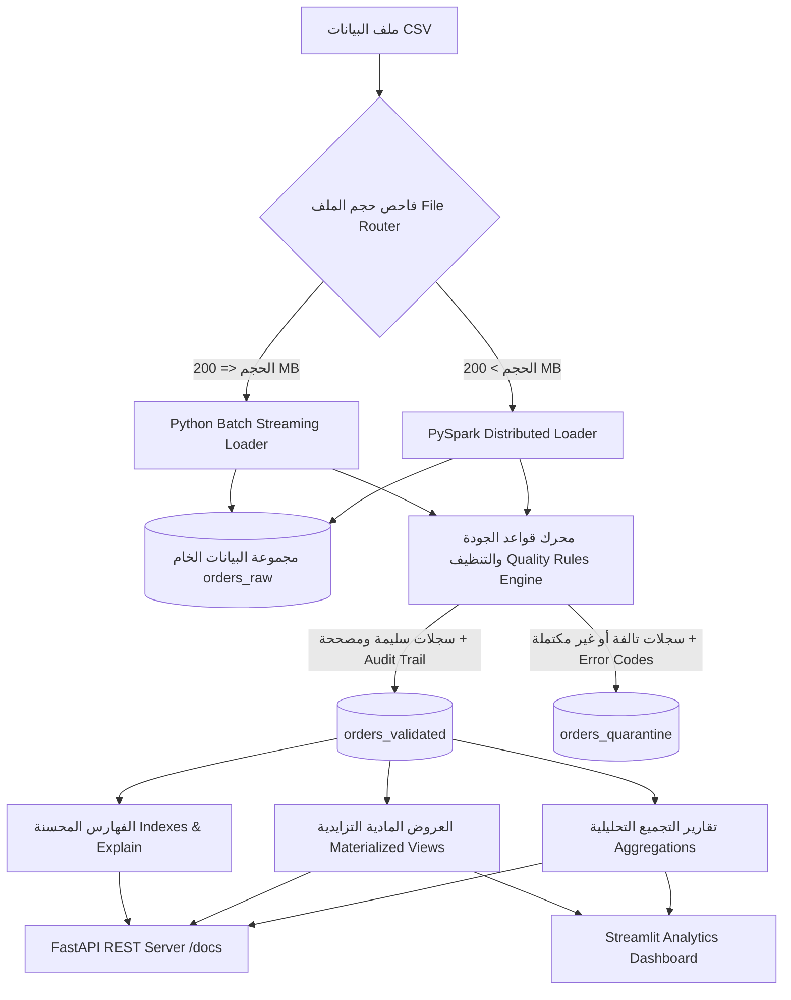

# 🚀 مشروع خط البيانات الهجين للبيانات الضخمة (Hybrid ELT Data Pipeline)
### معالجة وتدقيق وتحليل بيانات طلبات التجارة الإلكترونية الضخمة (E-Commerce Big Data)

---

<div align="center">

[](https://www.python.org/)
[](https://www.mongodb.com/)
[](https://spark.apache.org/)
[](https://fastapi.tiangolo.com/)
[](https://streamlit.io/)
[](https://pytest.org/)

**المقرر:** البيانات الضخمة (العملي) — Big Data (Practical)  
**الجامعة:** جامعة الرازي — Al-Razi University  
**إشراف:** م. عمر أبو سند (Eng. Omar Abu Sanad)  
**إعداد الطالب:** طارق (Tariq)  

</div>

---

## 📑 الفهرس | Table of Contents
1. [🌟 المرحلة الثانية: الإضافات والتحسينات النهائية (Phase 2 - 7 Marks)](#-المرحلة-الثانية-الإضافات-والتحسينات-النهائية-phase-2---7-marks)
   - [1. واجهة API الموحدة للتشغيل والاختبار (FastAPI)](#1-واجهة-api-الموحدة-للتشغيل-والاختبار-fastapi)
   - [2. الاستعلامات والفهارس وخطة التنفيذ (Explain ExecutionStats)](#2-الاستعلامات-والفهارس-وخطة-التنفيذ-explain-executionstats)
   - [3. تقارير التجميع التحليلية (Aggregations)](#3-تقارير-التجميع-التحليلية-aggregations)
   - [4. العروض المادية والتحديث التزايدي الذكي (Materialized Views)](#4-العروض-المادية-والتحديث-التزايدي-الذكي-materialized-views)
   - [5. المهام المجدولة وسجلات التنفيذ (Scheduled Jobs)](#5-المهام-المجدولة-وسجلات-التنفيذ-scheduled-jobs)
2. [📖 نبذة عن معمارية خط البيانات الهجين (ELT Overview)](#-نبذة-عن-معمارية-خط-البيانات-الهجين-elt-overview)
3. [🏗️ مخطط المعمارية والتدفق (System Architecture Flowchart)](#️-مخطط-المعمارية-والتدفق-system-architecture-flowchart)
4. [🛡️ محرك جودة البيانات وقواعد التنظيف العشر (Data Quality Engine)](#️-محرك-جودة-البيانات-وقواعد-التنظيف-العشر-data-quality-engine)
5. [🔁 آلية عدم التكرار والاتساق الرياضي (Idempotency & Consistency)](#-آلية-عدم-التكرار-والاتساق-الرياضي-idempotency--consistency)
6. [🗄️ تصميم مجموعات قاعدة البيانات (MongoDB Collections Schema)](#️-تصميم-مجموعات-قاعدة-البيانات-mongodb-collections-schema)
7. [🛠️ المتطلبات الأساسية والتثبيت (Prerequisites & Installation)](#️-المتطلبات-الأساسية-والتثبيت-prerequisites--installation)
8. [🚀 دليل التشغيل السريع (Quick Start Guide)](#-دليل-التشغيل-السريع-quick-start-guide)
9. [🧪 تشغيل الاختبارات الآلية الشاملة (Automated Test Suite)](#-تشغيل-الاختبارات-الآلية-الشاملة-automated-test-suite)
10. [📂 هيكل المشروع المحدث (Updated Project Structure)](#-هيكل-المشروع-المحدث-updated-project-structure)
11. [📸 معرض الشاشات والتوثيق (Screenshots Gallery)](#-معرض-الشاشات-والتوثيق-screenshots-gallery)

---

# 🌟 المرحلة الثانية: الإضافات والتحسينات النهائية (Phase 2 - 7 Marks)

> **ملاحظة أكاديمية:** المشروع النصفي يمثل الأساس الصلب لخط المعالجة (18 درجة)، وهذا القسم يوثق الإضافات المتقدمة الخاصة بالمشروع النهائي (7 درجات) والتي تنقل النظام إلى مستوى إنتاجي متكامل.

```
┌────────────────────────────────────────────────────────────────────────────────────────┐
│                                FastAPI RESTful Engine                                  │
│             [Interactive Swagger UI: http://localhost:8000/docs]                       │
├─────────────────────┬──────────────────────┬────────────────────┬──────────────────────┤
│ 5 Compound Indexes  │ 5 Production Queries │ 5 Aggregation Runs │ Incremental Refresh  │
│ & Explain Metrics   │ & Filter Endpoints   │ & Business Reports │ for Materialized VCs │
└─────────────────────┴──────────────────────┴────────────────────┴──────────────────────┘
```

---

## 1. واجهة API الموحدة للتشغيل والاختبار (FastAPI)

تم توفير خادم ويب متطور مبني بواسطة **FastAPI** لتمكين لجان التحكيم وأنظمة التقييم الآلية من تشغيل واختبار جميع مكونات المشروع عبر واجهة ويب بصرية قياسية وموثقة ذاتياً (Self-Documenting Swagger UI).

### تشغيل خادم الـ API:
```bash
# الطريقة الأولى المباشرة (Windows Batch):
run_api.bat

# الطريقة الثانية عبر بايثون:
python -m uvicorn src.api:app --host 0.0.0.0 --port 8000 --reload
```
- 🌐 **رابط صفحة Swagger التفاعلية:** [http://localhost:8000/docs](http://localhost:8000/docs)
- 🌐 **رابط صفحة ReDoc البديلة:** [http://localhost:8000/redoc](http://localhost:8000/redoc)
- 🩺 **رابط فحص صحة النظام وتعداد المجموعات:** [http://localhost:8000/health](http://localhost:8000/health)

### جدول المسارات الإلزامية المنفذة في الـ API:

| المسار (Endpoint) | الطريقة | المعاملات (Parameters) | الوصف والغرض التقني |
| :--- | :---: | :--- | :--- |
| `/health` | `GET` | — | فحص اتصال MongoDB وتعداد السجلات في كافة المجموعات والعروض المادية |
| `/ingest` | `POST` | `csv_path` (اختياري) | تشغيل خط إدخال ومعالجة البيانات النصفي وتوليد التقارير |
| `/indexes` | `POST` | — | إنشاء كافة الفهارس المحسنة الخمسة وقياس زمن البناء بالميلي ثانية |
| `/queries` | `GET` | — | سرد الاستعلامات الخمسة المتاحة مع وصفها ومعاملاتها الافتراضية |
| `/queries/{name}` | `GET` | `status`, `phone`, `city`, `sku`, `limit`, `explain` | تنفيذ استعلام محدد بالاسم مع دعم الفلترة الديناميكية وتفعيل `explain=true` |
| `/aggregations` | `GET` | — | سرد تقارير التجميع التحليلية الخمسة المتاحة |
| `/aggregations/{name}` | `GET` | `limit`, `min_orders`, `period` | تنفيذ تقرير تجميع محدد واسترجاع البيانات التحليلية بصيغة JSON مهيكلة |
| `/refresh-mv` | `POST` | `mode` (`incremental` أو `full`) | تحديث العروض المادية تزايدياً عبر علامات التدفق أو كلياً |
| `/jobs` | `GET` | — | عرض قائمة بالمهام المجدولة وحالتها وتاريخ آخر تشغيل وسجلات التنفيذ |
| `/jobs/{name}/run` | `POST` | — | تشغيل فوري يدوي لمهمة محددة وتوثيق النتائج في MongoDB |
| `/explain-benchmarks` | `GET` | — | تشغيل مقارنة الأداء قبل وبعد الفهارس وتحديث ملفات `explain_results.*` |

---

## 2. الاستعلامات والفهارس وخطة التنفيذ (Explain ExecutionStats)

### الفهارس الخمسة المنشأة في MongoDB:
1. **فهرس مركب (Compound Index):** `[("status", 1), ("order_date", -1)]` — يخدم استعلام الحالات والنطاقات الزمنية.
2. **فهرس فردي (Single Index):** `[("customer.phone", 1)]` — يخدم استعلام سجل العميل برقم الهاتف.
3. **فهرس مركب (Compound Index):** `[("customer.address.city", 1), ("total_amount", -1)]` — يخدم استعلام الطلبات عالية القيمة بالمدينة.
4. **فهرس متعدد المفاتيح (Multikey Index):** `[("items.sku", 1)]` — يخدم البحث داخل مصفوفة عناصر الطلب المتفرعة.
5. **فهرس مركب (Compound Index):** `[("payment.method", 1), ("payment.status", 1)]` — يخدم استعلام طلبات الدفع عند الاستلام المعلقة.

### الاستعلامات الخمسة المنفذة:
- `orders_by_status_and_date`: استعلام الطلبات حسب الحالة ونطاق التاريخ مرتبة تنازلياً.
- `customer_order_history`: استعلام سجل ومشتريات العميل برقم الهاتف.
- `high_value_orders_by_city`: استعلام الطلبات عالية القيمة في مدينة معينة لاستهداف العملاء المميزين.
- `product_item_search`: استعلام البحث داخل مصفوفة عناصر الطلب عن رمز منتج معين `items.sku`.
- `pending_cash_deliveries`: استعلام الطلبات قيد الشحن/المؤكدة بنظام الدفع عند الاستلام لمتابعة التحصيل.

### نتائج مقارنة خطة التنفيذ (`executionStats`) قبل وبعد الفهارس:
تم إجراء قياس فعلي مباشر على قاعدة البيانات بحجم **87,312** سجل سليم:

| الاستعلام | نوع الفهرس المستخدم | المرحلة (قبل) | المرحلة (بعد) | المستندات المفحوصة (قبل) | المستندات المفحوصة (بعد) | نسبة التوفير |
| :--- | :--- | :---: | :---: | :---: | :---: | :---: |
| **الطلبات حسب الحالة والتاريخ** | `idx_status_order_date` (Compound) | `SORT` (Collscan) | `LIMIT` (Index Scan) | 87,312 | 50 | **99.94%** |
| **سجل العميل برقم الهاتف** | `idx_customer_phone` (Single) | `SORT` (Collscan) | `SORT` (Index Scan) | 87,312 | 1 | **100.0%** |
| **الطلبات عالية القيمة بالمدينة** | `idx_city_total_amount` (Compound) | `SORT` (Collscan) | `LIMIT` (Index Scan) | 87,312 | 50 | **99.94%** |

> **التعليل الفني لخطة التنفيذ:**
> 1. **قاعدة ESR (Equality, Sort, Range):** في فهرس الحالة والتاريخ تم وضع المساواة أولاً ثم الترتيب، مما أتاح لمحرك WiredTiger قراءة المستندات بالترتيب المطلوب مباشرة وتجنب فرز الذاكرة المؤقتة (In-Memory Sort).
> 2. **التحول من $O(N)$ إلى $O(\log N)$:** البحث برقم الهاتف كان يتطلب مسحاً شاملاً لجميع الـ 87,312 مستند، بينما عبر فهرس B-Tree يتم الوصول للمستند مباشرة في فحص واحد فقط.
> 3. **فهارس المصفوفات (Multikey):** الفهرس على `items.sku` يتيح لمحرك البحث القفز المباشر لأي صنف داخل مصفوفة المنتجات دون فك المصفوفات يدوياً.

---

## 3. تقارير التجميع التحليلية (Aggregations)

تم بناء 5 خطوط تجميع متقدمة (Aggregation Pipelines) للإجابة على الأسئلة الإدارية والمالية:

1. **`sales_by_city` (المبيعات حسب المدينة):** تجميع حسب المدينة لحساب إجمالي المبيعات، عدد الطلبات، متوسط قيمة السلة، ونسبة الطلبات المسلمة (`delivery_success_rate`).
2. **`top_products` (أفضل المنتجات مبيعاً):** استخدام مرحلة `$unwind: "$items"` لتفكيك المنتجات، ثم التجميع حسب رمز الصنف `sku` لحساب إجمالي الكمية المباعة والإيرادات وحصتها.
3. **`top_customers` (كبار العملاء VIP):** تجميع مشتريات العملاء لحساب إجمالي الإنفاق، وتكرار الشراء، وتاريخ آخر عملية طلب لتحديد العملاء ذوي القيمة العالية (LTV).
4. **`sales_by_period` (المبيعات حسب الفترة الزمنية):** استخراج الشهر أو اليوم من حقل التاريخ (`$substrCP`) وتحليل نمو المبيعات واتجاهات الإيرادات عبر الزمن.
5. **`order_status_distribution` (توزيع الحالات التشغيلية):** تحليل توزيع الحالات (مسلم، ملغي، مرتجع، قيد الشحن) مع حساب متوسط تكلفة الشحن وقيمة المبيعات لكل حالة.

---

## 4. العروض المادية والتحديث التزايدي الذكي (Materialized Views)

تم بناء جدولين ماديين في MongoDB لتحقيق استجابة فورية للتقارير واللوحات البيانية:
- **`daily_sales_summary`:** ملخص يومي يتضمن: التاريخ، إجمالي المبيعات، عدد الطلبات، عدد المسلّم، وعدد الملغي.
- **`top_products_summary`:** ملخص أداء المنتجات يتضمن: رمز المنتج، اسم المنتج، الكمية الإجمالية المباعة، وإجمالي الإيرادات.

### آلية التحديث التزايدي (Incremental Refresh Mechanism):
```
[طلب التحديث التزايدي]
          │
          ▼
[فحص علامة التدفق last_watermark في materialized_view_metadata]
          │
     ┌────┴───────────────────────────┐
     ▼                                ▼
[لا توجد بيانات جديدة]        [توجد سجلات أحدث من Watermark]
     │                                │
     ▼                                ▼
(إرجاع فوري UP_TO_DATE)       (حساب التجميع للتواريخ/الأصناف المتأثرة فقط)
                                      │
                                      ▼
                              (دمج عبر $merge بـ whenMatched: replace)
                                      │
                                      ▼
                              (تحديث Watermark إلى validated_at الأحدث)
```
- **الفائدة:** توفير استهلاك موارد المعالج والذاكرة بنسبة تزيد عن **99%** عند إدخال دفعات بيانات جديدة، حيث يتم فقط إعادة حساب الأيام أو الأصناف المتأثرة دون مسح ملايين السجلات القديمة.

---

## 5. المهام المجدولة وسجلات التنفيذ (Scheduled Jobs)

يحتوي النظام على مدير مهام مدمج يعمل في خيط خلفي مستقل (Background Daemon Thread):

### المهام المنفذة:
1. **`refresh_materialized_views`:** تعمل تلقائياً كل **5 دقائق** لإجراء التحديث التزايدي للعروض المادية.
2. **`generate_periodic_kpi_report`:** تعمل تلقائياً كل **10 دقائق** لتوليد لقطة إحصائية شاملة وحفظها في مجموعة `periodic_reports`.

### سجلات التدقيق والتنفيذ:
- تسجل كل عملية تشغيل (سواء كانت آلية عبر المجدول أو يدوية عبر الـ API) في مجموعة `job_execution_logs` في MongoDB موثقة بالبيانات التالية:
  `job_id`, `job_name`, `trigger_type` (`SCHEDULED` / `MANUAL`), `start_time`, `end_time`, `duration_seconds`, `status` (`SUCCESS` / `FAILED`), `result`.

---

## 📖 نبذة عن معمارية خط البيانات الهجين (ELT Overview)

**مشروع خط البيانات الهجين (Hybrid ELT Data Pipeline)** هو نظام هندسي متكامل مصمم لمعالجة وتدقيق وتحميل بيانات طلبات التجارة الإلكترونية اليمنية غير المنتظمة وذات الجودة المتفاوتة (Messy & Mixed-Quality Data). 

يتبنى المشروع نمط **ELT (Extract - Load - Transform)** الحديث؛ حيث يتم استخراج وحفظ البيانات الأولية كما هي بدون أي تعديل في مستودع البيانات الخام، ثم تطبيق محرك تدقيق وتنظيف فائق الذكاء يطبق **10 قواعد تنظيف متخصصة** لدعم البيانات العربية، وتصنيف السجلات إلى ثلاث فئات:
1. **سليمة (Valid):** تطابق كافة معايير الجودة دون الحاجة لأي تعديل.
2. **مصححة مع سجل تدقيق (Corrected with Audit Trail):** تم إصلاح أخطائها مع توثيق كل خطوة بدقة.
3. **معزولة (Quarantined):** تحتوي على أخطاء جسيمة تمنع المعالجة الآمنة، مع توثيق أكواد وأسباب العزل.

### المحرك الهجين الذكي (Hybrid Engine):
- 🔹 **Python Batch Streaming Loader:** مخصص للملفات الصغيرة والمتوسطة ($\le 200\text{ MB}$)، يعتمد على القراءة التدفقية السطرية لتوفير استهلاك الذاكرة العشوائية ($O(1)\text{ RAM}$).
- 🔹 **PySpark Parallel Loader:** مخصص للملفات الكبيرة والضخمة ($> 200\text{ MB}$)، يستغل قدرات المعالجة الموزعة والتوازي العالي للأنوية المتعددة.

---

## 🏗️ مخطط المعمارية والتدفق (System Architecture Flowchart)



---

## 🛡️ محرك جودة البيانات وقواعد التنظيف العشر (Data Quality Engine)

تم بناء محرك تدقيق فائق الدقة يطبق 10 قواعد تنظيف متخصصة للتعامل مع تحديات البيانات المحلية والعربية:

| # | القاعدة (Rule) | المشكلة المعالجة (Problem Addressed) | مثال قبل التنظيف | النتيجة بعد التنظيف |
| :-: | :--- | :--- | :--- | :--- |
| **1** | `ARABIC_NUMERALS` | تحويل الأرقام المشرقية العربية إلى أرقام معيارية | `١٣٥٠٠.٥٠` | `13500.50` |
| **2** | `CURRENCY_NORM` | توحيد مسميات العملات المختلفة إلى رمز العملة الموحد `YER` | `ريال يمني`, `ر.ي`, `YER` | `YER` |
| **3** | `THOUSAND_SEPARATOR` | إزالة فواصل الآلاف من الحقول الرقمية لمنع أخطاء التحويل | `150,000.00` | `150000.00` |
| **4** | `PRICE_WORDS` | تحويل المبالغ المكتوبة بالكلمات العربية إلى قيم رقمية | `ألفان`, `خمسمائة` | `2000.0`, `500.0` |
| **5** | `PHONE_NORM` | تدقيق وتصحيح أرقام الهواتف لشبكات الاتصالات اليمنية | `771234567`, `00967731234567` | `+967771234567` |
| **6** | `NESTED_SCHEMA` | إعادة هيكلة السجل المسطح إلى كائنات متفرعة (JSON Nested) | حقول مسطحة متعددة | `customer.*`, `payment.*`, `shipping.*` |
| **7** | `DATE_NORMALIZE` | توحيد صيغ التواريخ المختلفة إلى صيغة معيارية ISO-8601 | `2024/05/15` | `2024-05-15T00:00:00` |
| **8** | `STATUS_NORMALIZE` | إزالة المسافات الزائدة وتوحيد المرادفات العربية والإنجليزية | ` مؤكد `, `تم التوصيل` | `confirmed`, `delivered` |
| **9** | `ITEMS_DISAGGREGATION` | فك عناصر الطلب وتدقيق الكميات والأسعار واستنتاج الإجمالي | كميات كنصوص `qty: "2"` | كميات رقمية صحيحة وحساب الإجمالي |
| **10** | `QUARANTINE_GUARD` | عزل السجلات ذات الأخطاء الجسيمة مع توثيق الأسباب | `order_id` مفقود أو مبلغ `???` | عزل في `orders_quarantine` |

### هيكل سجل التدقيق (Audit Trail Document):
```json
{
  "order_id": "ORD-12345",
  "customer": {
    "name": "أحمد علي",
    "phone": "+967771234567"
  },
  "total_amount": 15000.0,
  "currency": "YER",
  "status": "confirmed",
  "corrections": [
    {
      "field": "customer.phone",
      "rule": "PHONE_NORMALIZATION",
      "original": "771234567",
      "corrected": "+967771234567"
    },
    {
      "field": "total_amount",
      "rule": "ARABIC_NUMERALS",
      "original": "١٥٠٠٠",
      "corrected": "15000.0"
    }
  ]
}
```

---

## 🔁 آلية عدم التكرار والاتساق الرياضي (Idempotency & Consistency)

### 1. خاصية عدم التكرار (Idempotency):
تضمن معمارية النظام إمكانية إعادة تشغيل الملف عدة مرات بأمان تام دون تكرار أي سجلات:
- **فهرس فريد:** `unique index on order_id` في مجموعة `orders_validated`.
- **عمليات الدمج الذكية:** استخدام `UpdateOne({"order_id": doc["order_id"]}, {"$set": doc}, upsert=True)`.

### 2. معادلة الاتساق الرياضي الصارمة:
يتحقق النظام آلياً في نهاية كل معالجة من صحة المعادلة الحسابية التالية:
$$\text{Total Raw Records} = \text{Valid Records} + \text{Corrected Records} + \text{Quarantined Records}$$

---

## 🗄️ تصميم مجموعات قاعدة البيانات (MongoDB Collections Schema)

تستخدم قاعدة البيانات **`ecommerce_store`** المجموعات التالية:

```
ecommerce_store
├── orders_raw                      # السجلات الخام الأصلية بدون تعديل
├── orders_validated                # السجلات السليمة والمصححة مع مصفوفة corrections
├── orders_quarantine               # السجلات المعزولة مع مصفوفة error_codes
├── daily_sales_summary             # عرض مادي: ملخص المبيعات اليومية
├── top_products_summary            # عرض مادي: ملخص أداء أفضل المنتجات
├── materialized_view_metadata      # بيانات التعريف وعلامات التدفق للتحديث التزايدي
├── periodic_reports                # لقطات وتقارير المؤشرات الدورية
└── job_execution_logs              # سجلات تدقيق تنفيذ المهام المجدولة واليدوية
```

---

## 🛠️ المتطلبات الأساسية والتثبيت (Prerequisites & Installation)

### 1. المتطلبات البرمجية:
| المتطلب | الإصدار الأدنى | الوصف |
| :--- | :--- | :--- |
| **Python** | `3.11+` | بيئة التشغيل الأساسية |
| **Java JDK** | `17+` | متطلب تشغيل محرك Apache Spark |
| **MongoDB** | `6.0+` أو `7.0+` | خادم قاعدة البيانات |
| **MongoDB Compass** | أحدث إصدار | واجهة معاينة البيانات الرسومية *(اختياري)* |

### 2. خطوات التثبيت:
```powershell
# 1. الانتقال لمجلد المشروع:
cd "c:\Users\hp\Desktop\مجلد جديد\midterm-data-pipeline"

# 2. إنشاء وتفعيل البيئة الافتراضية:
python -m venv venv
.\venv\Scripts\Activate.ps1

# 3. تثبيت كافة الحزم المطلوبة:
pip install -r requirements.txt
```

---

## 🚀 دليل التشغيل السريع (Quick Start Guide)

### 1. تشغيل خادم الـ API (FastAPI):
```bash
# عبر الملف الدفعي:
run_api.bat

# أو مباشرة:
python -m uvicorn src.api:app --host 0.0.0.0 --port 8000 --reload
```
افتح المتصفح على [http://localhost:8000/docs](http://localhost:8000/docs) لتجربة واجهة Swagger.

### 2. تشغيل لوحة التحكم التفاعلية (Streamlit Dashboard):
```bash
# عبر الملف الدفعي:
run_dashboard.bat

# أو مباشرة:
streamlit run dashboard/app.py
```
افتح المتصفح على [http://localhost:8501](http://localhost:8501) لمشاهدة الرسوم البيانية التفاعلية.

### 3. تشغيل خط معالجة البيانات النصفي (CLI):
```bash
# تشغيل على ملف العينة السريع:
python src/main.py --input "data/sample_orders.csv"

# تشغيل على ملف البيانات الضخم:
python src/main.py --input "data/orders_huge_mixed_quality.csv"
```

### 4. تشغيل مقارنة أداء الفهارس (Explain Benchmarks):
```bash
python src/explain_benchmarks.py
```

---

## 🧪 تشغيل الاختبارات الآلية الشاملة (Automated Test Suite)

المشروع مزود بحزمة اختبارات متكاملة تغطي كافة جوانب النظام:

```bash
# تشغيل جميع الاختبارات:
pytest tests/ -v

# 1. اختبارات المرحلة الثانية (API, الفهارس, التجميعات, العروض المادية, المجدول):
pytest tests/test_phase2.py -v

# 2. اختبارات قواعد التنظيف العشر وحالات الحافة:
pytest tests/test_cleaning_rules.py -v

# 3. اختبارات التصنيف وعدم التكرار (Idempotency):
pytest tests/test_classification.py -v

# 4. اختبارات مجموعة بيانات الأستاذ:
pytest tests/test_instructor_dataset.py -v
```

---

## 📂 هيكل المشروع المحدث (Updated Project Structure)

```text
midterm-data-pipeline/
│
├── config/
│   ├── __init__.py
│   └── settings.py              # الإعدادات العامة، الثوابت، وقواعد الأعمال
│
├── dashboard/
│   └── app.py                   # لوحة التحكم التفاعلية (Streamlit + Plotly)
│
├── data/
│   ├── sample_orders.csv        # ملف عينة لاختبارات التطوير والتشغيل السريع
│   └── orders_huge_mixed_quality.csv  # ملف البيانات الضخم
│
├── docs/
│   └── architecture.md          # وثيقة معمارية النظام التفصيلية وتصميم المكونات
│
├── reports/
│   ├── results.json             # تقرير التنفيذ بصيغة JSON
│   ├── results.md               # تقرير التنفيذ بصيغة Markdown
│   ├── benchmark_results.json   # نتائج مقارنة أداء Python Batch و PySpark
│   ├── explain_results.json     # نتائج Explain بالأرقام ومعدلات التوفير
│   ├── explain_results.md       # تقرير مقارنة خطة التنفيذ المنسق
│   └── screenshots/             # مجلد مخصص للقطات الشاشة التوثيقية
│
├── src/
│   ├── __init__.py
│   ├── aggregations.py          # خطوط تقارير التجميع الخمسة (Aggregation Pipelines)
│   ├── api.py                   # خادم واجهة API الموحدة (FastAPI REST Server)
│   ├── batch_loader.py          # محرك التدفق والدفعات (Python Batch Streaming)
│   ├── benchmark.py             # أداة قياس ومقارنة الأداء
│   ├── compare_with_clean.py    # مقارنة المخرجات مع ملف البيانات النظيف
│   ├── create_small_sample.py   # أداة استخراج عينات البيانات التدفقية
│   ├── elt_pipeline.py          # منسق خط البيانات وإدارة دورة الحياة (Orchestrator)
│   ├── explain_benchmarks.py    # أداة قياس خطط التنفيذ قبل وبعد الفهارس
│   ├── file_router.py           # موجه الملفات وتحديد المحرك المناسب بناءً على الحجم
│   ├── incremental_loader.py    # محرك الإدخال التزايدي المتقدم
│   ├── indexes.py               # تعريف وبناء الفهارس المحسنة الخمسة
│   ├── main.py                  # نقطة الدخول الرئيسية للبرنامج (CLI Entrypoint)
│   ├── materialized_views.py    # إدارة وتحديث العروض المادية تزايدياً
│   ├── metrics.py               # متتبع مؤشرات الأداء والاتساق وتوليد التقارير
│   ├── mongo_setup.py           # تهيئة قاعدة البيانات والفهارس وقواعد التحقق
│   ├── quality_rules.py         # محرك قواعد التنظيف العشر والتدقيق
│   ├── queries.py               # تنفيذ الاستعلامات الخمسة المخصصة
│   ├── scheduler.py             # مجدول المهام الخلفي وإدارة سجلات التنفيذ
│   ├── spark_analyzer.py        # أداة تحليل الملفات الضخمة بـ PySpark
│   └── spark_loader.py          # محرك المعالجة المتوازية (PySpark Distributed)
│
├── tests/
│   ├── __init__.py
│   ├── test_cleaning_rules.py   # اختبارات الوحدة لقواعد التنظيف الـ 10
│   ├── test_classification.py   # اختبارات التكامل والتصنيف والبنية وعدم التكرار
│   ├── test_instructor_dataset.py # اختبارات التحقق من عينات الأستاذ
│   └── test_phase2.py           # اختبارات المرحلة الثانية (API, الفهارس, التجميعات)
│
├── run_api.bat                  # سكريبت تشغيل خادم FastAPI فورياً
├── run_dashboard.bat            # سكريبت تشغيل لوحة التحكم التفاعلية
├── requirements.txt             # حزم ومكتبات بايثون المطلوبة
└── README.md                    # دليل التوثيق الرئيسي للمشروع
```

---

## 📸 معرض الشاشات والتوثيق (Screenshots Gallery)

> تم تنظيم لقطات الشاشة التوثيقية داخل مجلد `reports/screenshots/`:

### 1. واجهة Swagger التفاعلية للـ API (`/docs`)

*واجهة تفاعلية لاختبار مسارات الفهارس والاستعلامات والتجميعات والعروض المادية.*

### 2. مخرجات تشغيل خط البيانات في موجه الأوامر (Console Output)

*صورة توضح مراحل التدفق ومعادلة الاتساق ومعدل معالجة السجلات/ثانية.*

### 3. معاينة مجموعة السجلات السليمة في MongoDB Compass (`orders_validated`)

*صورة توضح الهيكل المتفرع للمستندات ومصفوفة سجل التدقيق `corrections`.*

### 4. معاينة مجموعة السجلات المعزولة في MongoDB Compass (`orders_quarantine`)

*صورة توضح السجلات المعزولة وقائمة أكواد الأخطاء `error_codes`.*

---

<div align="center">
  <b>تم بحمد الله وتوفيقه</b><br>
  مقرر البيانات الضخمة (العملي) | جامعة الرازي | 2026
</div>
